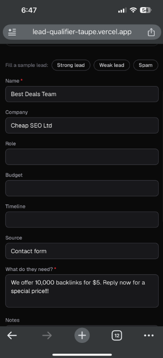
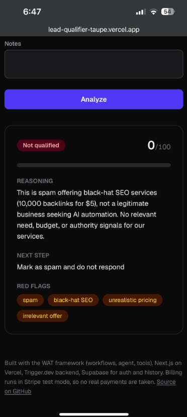

# AI Lead Qualifier

[](https://github.com/MansoorAlmarar/lead-qualifier/actions/workflows/ci.yml)

A full-stack app that takes a sales lead (name, company, role, budget, need, timeline, source, notes) and returns a structured verdict: qualified or not, a score out of 100, the reasoning, red flags and a suggested next step. Auth, saved history and a free/Pro billing tier are built in. It is a portfolio project: the point is a complete, deployed agent-style workflow, not a production CRM.

**Live demo:** https://lead-qualifier-taupe.vercel.app (create a free account to try it; use fictional data only)

<p>
  
  
  
</p>

_Left to right: the lead form, a result for the spam sample, and the private history (phone width, dark mode)._

## The problem

Small teams get inbound leads of very uneven quality: real buyers, vague students, spam. Reading each one and deciding whether it deserves a sales call is slow and inconsistent. This app applies one written set of criteria to every lead and explains its answer, so a human can skim the verdict and spend time only on the good ones.

## Features

- Lead form with a one-click "Fill a sample lead" row (strong, weak, spam). Samples are fictional.
- AI qualification with a validated JSON result: `qualified`, `score`, `reasoning`, `next_step`, `red_flags`.
- Email and password sign-up and login (Supabase Auth).
- Private history of past analyses (Supabase Postgres with row-level security).
- Free plan: 2 analyses per day (resets at midnight Dubai time). Pro: unlimited, via Stripe Checkout. **Stripe runs in test mode only. No real money moves.**
- Loading, error, empty and limit-reached states. Responsive layout with light and dark mode.
- Abuse protection: per-user rate limit, input length caps, daily quota.

## Architecture

```
Browser form
   |  POST /api/analyze
   v
Next.js route (Vercel, server-side)  --tasks.trigger-->  Trigger.dev task "qualify-lead"
   ^                                                          |
   |  GET /api/runs/:id (polled)                              v
   +-------------------- result JSON <------------------  OpenRouter (LLM)

Supabase: auth + lead_history + subscriptions      Stripe (test mode): Checkout, portal, webhook
```

- **Frontend (`frontend/`):** Next.js App Router on Vercel. A proxy (`frontend/proxy.ts`) sends logged-out visitors to `/login`, and each API route checks the user again.
- **Backend (`tools/`):** a Trigger.dev task validates the lead with zod, calls the LLM through OpenRouter, validates the JSON it returns, and hands it back. The prompt lives in its own file (`tools/prompt.ts`).
- **Supabase:** Auth, plus `lead_history` and `subscriptions` tables. Row-level security limits users to their own rows (`supabase/schema.sql`, `supabase/billing.sql`).
- **Trigger.dev:** runs the long-ish LLM call outside the request. The browser polls `/api/runs/:id` for the result. The Trigger.dev secret key is only used in server routes.
- **Stripe (test mode):** Checkout for the $29/month Pro plan, the customer portal for cancel and card changes, and a signature-verified webhook (`/api/stripe/webhook`) that keeps `subscriptions` in sync.
- **Model fallback:** the task tries a paid model first (`openai/gpt-4o-mini`), then falls back to free OpenRouter models on credit, rate limit or provider errors. Model ids live in `tools/qualify-lead.ts`.

### The WAT framework

The repo is organised the way I work with Claude Code:

| Part | Folder | What it is |
|---|---|---|
| **W**orkflows | `workflows/` | Plain-language SOP: objective, inputs, steps, edge cases |
| **A**gent | Claude Code | Reads the workflow, writes and runs the tools, fixes errors |
| **T**ools | `tools/` | The Trigger.dev task, prompt and schemas that do the work |

`CLAUDE.md` holds the standing instructions for the agent.

## Tech stack

- TypeScript, Next.js (App Router), React, Tailwind CSS
- Trigger.dev v4 (background task)
- OpenRouter (OpenAI-compatible LLM API)
- Supabase (Auth, Postgres, row-level security)
- Stripe (Checkout, customer portal, webhooks; test mode)
- zod (validation at the route and in the task)
- Vercel (frontend hosting)

## Project layout

```
workflows/lead-qualifier.md   what the workflow should do
tools/                        Trigger.dev task, prompt, schemas
trigger.config.ts             Trigger.dev project config
frontend/                     Next.js app (deployed to Vercel)
evals/                        model comparison: labelled fictional leads, runner, scorer
supabase/schema.sql           history table and row-level security policies
supabase/billing.sql          subscriptions table (written by the Stripe webhook)
docs/cv-bullets.md            CV and LinkedIn wording for this project
```

## Run locally

Requires Node 20+, a Trigger.dev account, an OpenRouter API key, a Supabase project and a Stripe account in test mode.

1. Install: `npm install` in the root and in `frontend/`.
2. Set `OPENROUTER_API_KEY` in your Trigger.dev project (Development environment).
3. Run `supabase/schema.sql` and `supabase/billing.sql` in the Supabase SQL Editor.
4. Copy `frontend/.env.example` to `frontend/.env.local` and fill in the variables below.
5. In the root: `npx trigger.dev@latest dev`
6. Install the Stripe CLI, run `stripe login`, then `stripe listen --forward-to localhost:3000/api/stripe/webhook`. Put the signing secret it prints in `STRIPE_WEBHOOK_SECRET`.
7. In `frontend/`: `npm run dev`, then open http://localhost:3000. Pay with Stripe's test card `4242 4242 4242 4242`.
8. Checks, in `frontend/`: `npm run lint`, `npm test` and `npm run build`. Tests run offline with Supabase, Stripe and Trigger.dev mocked, so they need no env vars or keys.
9. Checks, in the root: `npm run typecheck`, `npm test` and `npm run eval -- --mock`. None of them needs a key.

### Environment variable names

Names only. Values go in `frontend/.env.local`, Vercel, or the Trigger.dev dashboard. Never commit them.

| Variable | Where it is set | Notes |
|---|---|---|
| `OPENROUTER_API_KEY` | Trigger.dev dashboard | Used by the task only |
| `TRIGGER_SECRET_KEY` | Frontend server (`.env.local` / Vercel) | Server-side only |
| `NEXT_PUBLIC_SUPABASE_URL` | Frontend | Public by design |
| `NEXT_PUBLIC_SUPABASE_PUBLISHABLE_KEY` | Frontend | Public by design; row-level security protects data |
| `SUPABASE_SERVICE_ROLE_KEY` | Frontend server | Used by the webhook; never `NEXT_PUBLIC_` |
| `STRIPE_SECRET_KEY` | Frontend server | Test-mode key |
| `STRIPE_WEBHOOK_SECRET` | Frontend server | From `stripe listen` or the webhook endpoint |
| `STRIPE_PRICE_ID` | Frontend server | Test-mode Pro price |

## Deploy

- **Backend:** `npx trigger.dev@latest deploy`. Set `OPENROUTER_API_KEY` in the Production environment.
- **Frontend:** import the repo in Vercel, set the root directory to `frontend`, and add the variables above. In Supabase, set the Site URL and redirect URLs to the Vercel domain.

## Model evaluation

The eval set compares models on the same leads. Each lead goes through the same prompt and schema as the Trigger.dev task. The answers are then scored against labels written in advance.

**What it measures**, per model, over 40 fictional leads:

- **Qualified accuracy:** share of leads where `qualified` matches the expected label.
- **Score-band hit rate:** share of leads where `score` falls inside the expected band.
- **MAE:** mean distance between `score` and the middle of the expected band, valid replies only.
- **Schema-valid rate:** share of replies that are JSON and pass `resultSchema` in `tools/schema.ts`.
- **Median latency:** median time per call.

An invalid reply counts as a miss for accuracy and band hits. Each model is called on its own, so the app's paid-then-free fallback is not tested.

**Run it**

Offline, with no keys and no cost. CI runs this mode:

```bash
npm run eval -- --mock
```

Live, through OpenRouter. This needs `OPENROUTER_API_KEY` and uses credit. CI never runs it:

```bash
OPENROUTER_API_KEY=your-key npm run eval
```

Models come from `EVAL_MODELS` (comma-separated ids), or from `evals/models.json` if that is not set. The default list is the models the app uses. Each run prints a Markdown table and writes it to `evals/results/`.

Mock mode uses two offline stand-ins. `mock:keyword` is a rule-based baseline. `mock:flaky` is the same baseline with deliberate faults. Neither is an LLM. They check the scorer and the parser, and they let the eval run in CI without keys.

**Sample output (mock mode, not an LLM result)**

No live run is committed, because that needs a key. The tables below come from mock mode. They describe the mock models only and say nothing about any AI model. The full file is `evals/results/sample-mock.md`.

| Model | Qualified accuracy | Score-band hit rate | MAE (points) | Schema-valid rate | Median latency |
|---|---|---|---|---|---|
| mock:keyword | 92.5% | 50.0% | 9.3 | 100.0% | 0 ms |
| mock:flaky | 50.0% | 27.5% | 10.1 | 57.5% | 0 ms |

| Model | Strong | Medium | Weak | Spam |
|---|---|---|---|---|
| mock:keyword | 12/12 | 8/10 | 9/10 | 8/8 |
| mock:flaky | 7/12 | 3/10 | 5/10 | 5/8 |

**Add a lead**

1. Add an object to `evals/dataset/leads.json`. It needs a unique `id`, a `category` (`strong`, `medium`, `weak` or `spam`), a `lead` that passes the app's lead schema, and an `expected` block.
2. Set `expected.qualified`, and a `score_min` to `score_max` band. A qualified lead's band must start at 60 or higher. A lead that is not qualified must end at 59 or lower. This follows the rule in `tools/prompt.ts`.
3. Update the counts in `CATEGORY_COUNTS` (`evals/dataset.ts`) to match. The tests fail if they differ.
4. Use fictional names and companies only. Then run `npm test`.

**Limits**

- **Fake data.** The 40 leads are invented. Real inbound leads are messier, with typos, half-filled fields and mixed languages.
- **Small set.** One lead is 2.5 points of accuracy. At 80% accuracy, the 95% interval on 40 leads is about ±12 points. A gap of ten points or less between two models is not meaningful.
- **One labeller.** The labels are the author's judgement, based on the criteria in `tools/prompt.ts`. No second person has checked them.
- **Fixed criteria.** The labels follow the four criteria for a fictional agency. A model that does well here has answered this prompt, not a different business's question.
- **One run, one setting.** Temperature is 0.2 and each model runs once. Scores vary between runs, and free models vary by time of day.
- **Latency is local.** It measures one machine's calls to OpenRouter, not the production path.
- **Mock results are not model results.** Only a live run tells you how a model performs.

The eval tests are separate from the frontend tests above. They cover the scorer, the parser, the dataset checks and the runner.

## Limitations and next steps

Honest list of what this is not:

- **Stripe is in test mode.** Pro is a demo of the billing flow, not a live product.
- **Visitors must sign up** before they can try it. A public, no-login demo would need a stricter abuse plan.
- **The rate limiter is in memory.** On serverless each instance has its own memory, so it slows casual abuse but is not a hard guarantee. The daily quota is enforced from the database.
- **Test coverage is partial.** 47 Vitest tests cover lead validation, the Dubai-time daily quota, the rate limiter and the API routes (`/api/analyze`, `/api/stripe/webhook`, `/api/billing/*`) with Supabase, Stripe and Trigger.dev mocked. Not tested yet: `/api/runs/[id]`, the auth routes, the Trigger.dev task, the UI and any end-to-end flow.
- **Free fallback models** can be slow or rate limited, and result quality varies by model.
- **Scoring criteria are fixed** for a fictional agency (see `workflows/lead-qualifier.md`). Next step: make them editable per user.
- **Other ideas:** CSV bulk import, CRM export, push result updates instead of polling, live model results in the eval set.

Lead data can be personal data. Please enter fictional leads only. Leads you submit are stored in Supabase under your account.
