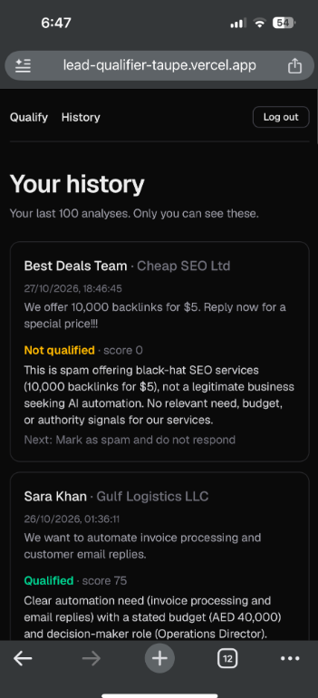

# AI Lead Qualifier

A full-stack app that takes a sales lead (name, company, role, budget, need, timeline, source, notes) and returns a structured verdict: qualified or not, a score out of 100, the reasoning, red flags and a suggested next step. Auth, saved history and a free/Pro billing tier are built in. It is a portfolio project: the point is a complete, deployed agent-style workflow, not a production CRM.

**Live demo:** https://lead-qualifier-taupe.vercel.app (create a free account to try it; use fictional data only)

<!-- Add screenshots to docs/screenshots/ and uncomment:


-->
_Screenshots: [add screenshots to `docs/screenshots/`]_

## The problem

Small teams get inbound leads of very uneven quality: real buyers, vague students, spam. Reading each one and deciding whether it deserves a sales call is slow and inconsistent. This app applies one written set of criteria to every lead and explains its answer, so a human can skim the verdict and spend time only on the good ones.

## Features

- Lead form with a one-click "Fill a sample lead" row (strong, weak, spam). Samples are fictional.
- AI qualification with a validated JSON result: `qualified`, `score`, `reasoning`, `next_step`, `red_flags`.
- Email and password sign-up and login (Supabase Auth).
- Private history of past analyses (Supabase Postgres with row-level security).
- Free plan: 2 analyses per day (resets at midnight Dubai time). Pro: unlimited, via Stripe Checkout. **Stripe runs in test mode only. No real money moves.**
- Loading, error, empty and limit-reached states. Responsive layout with light and dark mode.
- Abuse protection: per-user rate limit, input length caps, daily quota.

## Architecture

```
Browser form
   |  POST /api/analyze
   v
Next.js route (Vercel, server-side)  --tasks.trigger-->  Trigger.dev task "qualify-lead"
   ^                                                          |
   |  GET /api/runs/:id (polled)                              v
   +-------------------- result JSON <------------------  OpenRouter (LLM)

Supabase: auth + lead_history + subscriptions      Stripe (test mode): Checkout, portal, webhook
```

- **Frontend (`frontend/`):** Next.js App Router on Vercel. A proxy (`frontend/proxy.ts`) sends logged-out visitors to `/login`, and each API route checks the user again.
- **Backend (`tools/`):** a Trigger.dev task validates the lead with zod, calls the LLM through OpenRouter, validates the JSON it returns, and hands it back. The prompt lives in its own file (`tools/prompt.ts`).
- **Supabase:** Auth, plus `lead_history` and `subscriptions` tables. Row-level security limits users to their own rows (`supabase/schema.sql`, `supabase/billing.sql`).
- **Trigger.dev:** runs the long-ish LLM call outside the request. The browser polls `/api/runs/:id` for the result. The Trigger.dev secret key is only used in server routes.
- **Stripe (test mode):** Checkout for the $29/month Pro plan, the customer portal for cancel and card changes, and a signature-verified webhook (`/api/stripe/webhook`) that keeps `subscriptions` in sync.
- **Model fallback:** the task tries a paid model first (`openai/gpt-4o-mini`), then falls back to free OpenRouter models on credit, rate limit or provider errors. Model ids live in `tools/qualify-lead.ts`.

### The WAT framework

The repo is organised the way I work with Claude Code:

| Part | Folder | What it is |
|---|---|---|
| **W**orkflows | `workflows/` | Plain-language SOP: objective, inputs, steps, edge cases |
| **A**gent | Claude Code | Reads the workflow, writes and runs the tools, fixes errors |
| **T**ools | `tools/` | The Trigger.dev task, prompt and schemas that do the work |

`CLAUDE.md` holds the standing instructions for the agent.

## Tech stack

- TypeScript, Next.js (App Router), React, Tailwind CSS
- Trigger.dev v4 (background task)
- OpenRouter (OpenAI-compatible LLM API)
- Supabase (Auth, Postgres, row-level security)
- Stripe (Checkout, customer portal, webhooks; test mode)
- zod (validation at the route and in the task)
- Vercel (frontend hosting)

## Project layout

```
workflows/lead-qualifier.md   what the workflow should do
tools/                        Trigger.dev task, prompt, schemas
trigger.config.ts             Trigger.dev project config
frontend/                     Next.js app (deployed to Vercel)
supabase/schema.sql           history table and row-level security policies
supabase/billing.sql          subscriptions table (written by the Stripe webhook)
docs/cv-bullets.md            CV and LinkedIn wording for this project
```

## Run locally

Requires Node 20+, a Trigger.dev account, an OpenRouter API key, a Supabase project and a Stripe account in test mode.

1. Install: `npm install` in the root and in `frontend/`.
2. Set `OPENROUTER_API_KEY` in your Trigger.dev project (Development environment).
3. Run `supabase/schema.sql` and `supabase/billing.sql` in the Supabase SQL Editor.
4. Copy `frontend/.env.example` to `frontend/.env.local` and fill in the variables below.
5. In the root: `npx trigger.dev@latest dev`
6. Install the Stripe CLI, run `stripe login`, then `stripe listen --forward-to localhost:3000/api/stripe/webhook`. Put the signing secret it prints in `STRIPE_WEBHOOK_SECRET`.
7. In `frontend/`: `npm run dev`, then open http://localhost:3000. Pay with Stripe's test card `4242 4242 4242 4242`.
8. Checks: `npm run lint` and `npm run build` in `frontend/`.

### Environment variable names

Names only. Values go in `frontend/.env.local`, Vercel, or the Trigger.dev dashboard. Never commit them.

| Variable | Where it is set | Notes |
|---|---|---|
| `OPENROUTER_API_KEY` | Trigger.dev dashboard | Used by the task only |
| `TRIGGER_SECRET_KEY` | Frontend server (`.env.local` / Vercel) | Server-side only |
| `NEXT_PUBLIC_SUPABASE_URL` | Frontend | Public by design |
| `NEXT_PUBLIC_SUPABASE_PUBLISHABLE_KEY` | Frontend | Public by design; row-level security protects data |
| `SUPABASE_SERVICE_ROLE_KEY` | Frontend server | Used by the webhook; never `NEXT_PUBLIC_` |
| `STRIPE_SECRET_KEY` | Frontend server | Test-mode key |
| `STRIPE_WEBHOOK_SECRET` | Frontend server | From `stripe listen` or the webhook endpoint |
| `STRIPE_PRICE_ID` | Frontend server | Test-mode Pro price |

## Deploy

- **Backend:** `npx trigger.dev@latest deploy`. Set `OPENROUTER_API_KEY` in the Production environment.
- **Frontend:** import the repo in Vercel, set the root directory to `frontend`, and add the variables above. In Supabase, set the Site URL and redirect URLs to the Vercel domain.

## Limitations and next steps

Honest list of what this is not:

- **Stripe is in test mode.** Pro is a demo of the billing flow, not a live product.
- **Visitors must sign up** before they can try it. A public, no-login demo would need a stricter abuse plan.
- **The rate limiter is in memory.** On serverless each instance has its own memory, so it slows casual abuse but is not a hard guarantee. The daily quota is enforced from the database.
- **No automated tests.** Validation and the quota logic are the first things to cover.
- **Free fallback models** can be slow or rate limited, and result quality varies by model.
- **Scoring criteria are fixed** for a fictional agency (see `workflows/lead-qualifier.md`). Next step: make them editable per user.
- **Other ideas:** CSV bulk import, CRM export, push result updates instead of polling, an eval set to compare models.

Lead data can be personal data. Please enter fictional leads only. Leads you submit are stored in Supabase under your account.
